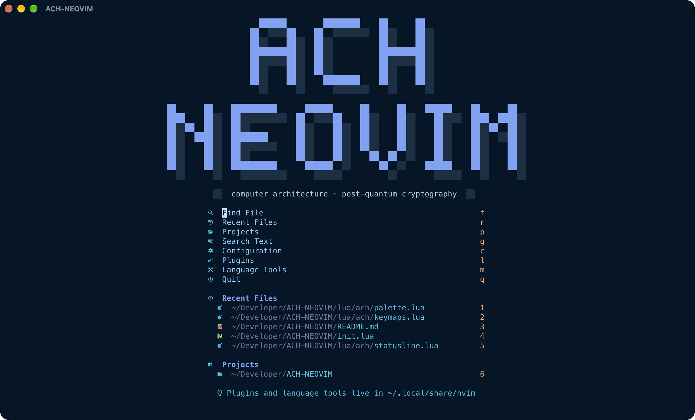
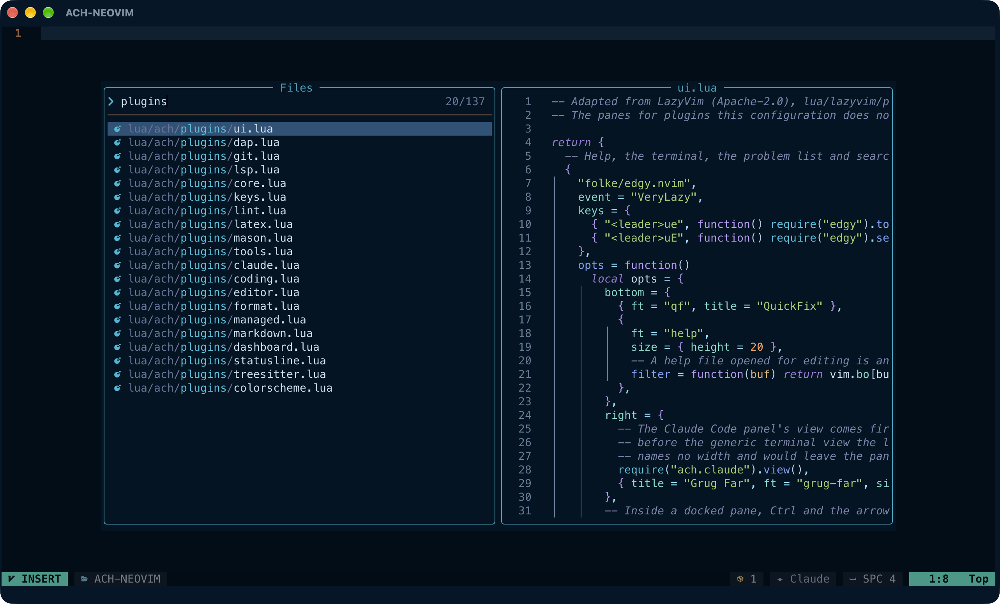

# ACH-NEOVIM

A Neovim distribution for one person's Mac, written from scratch on lazy.nvim. It carries a deep-navy tokyonight theme, a tiled status bar, the ACH NEOVIM start screen, every language the owner might open with highlighting, intellisense, completion, formatting, linting and grammar checking, and Claude Code inside the editor.

It needs Neovim 0.12 or later. To try it, clone it into `~/.config/nvim` and start `nvim`. The first start installs the plugins.

The design is in `docs/specs/2026-10-10-ach-neovim-design.md`. `scripts/check` runs the headless test suite. `scripts/update --list` names what an update would move, and `scripts/update` moves it, runs `scripts/check --full` and commits the lock files only when that passes, putting every plugin and Mason package back otherwise. The first time Neovim starts on a screen after Homebrew moves it to a new release, it runs `scripts/check` in the background and says whether the configuration still passes.

LazyVim, by Folke Lemaitre, is the reference this configuration learned from. Nothing here imports it, and files that adapt one of its functions say so. LazyVim is Apache-2.0 licensed.

ACH-NEOVIM is MIT licensed.
